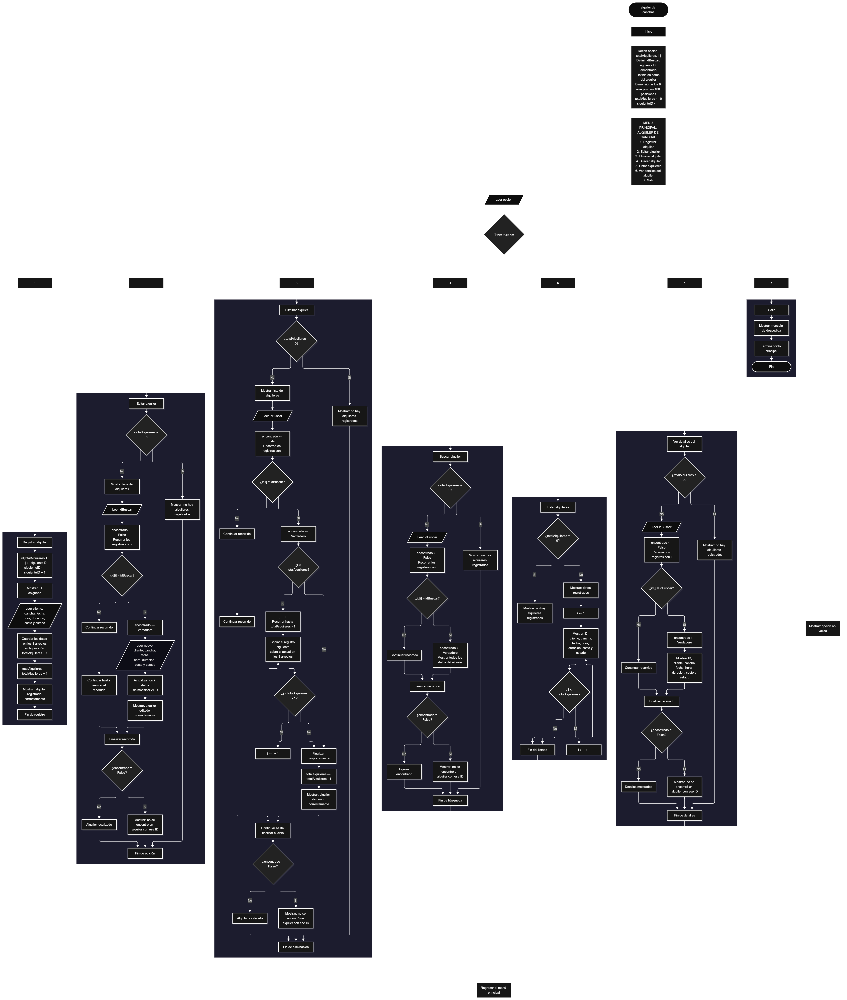

 

Este proyecto, llamado <b>alquiler de canchas</b>, fue desarrollado en <b>PSeInt</b> como un ejercicio práctico para fortalecer la lógica de programación mediante la creación de un sistema de gestión de alquileres de canchas deportivas desde la consola. El programa cuenta con un menú principal de siete opciones que permite <b>registrar, editar, eliminar, buscar, listar y consultar los detalles</b> de los alquileres registrados. Cada alquiler almacena información como el identificador, el nombre del cliente, el nombre de la cancha, la fecha, la hora, la duración, el costo y el estado del alquiler, utilizando ocho arreglos con una capacidad declarada de <b>100 posiciones cada uno</b>. Durante su desarrollo se aplicaron conceptos fundamentales de programación, como variables, arreglos, estructuras condicionales, ciclos repetitivos y estructuras de selección, además de procesos para buscar, modificar, eliminar y reorganizar registros. Este proyecto permite poner en práctica los conocimientos adquiridos en PSeInt y sirve como base para desarrollar sistemas de gestión más avanzados utilizando otros lenguajes y tecnologías.

<h2 align="center">⚙️ Funcionamiento del menú principal</h2>

### ➕ Registrar alquiler

La opción <b>1) registrar alquiler</b> permite registrar una nueva reserva de cancha. Primero, el programa asigna un identificador único al alquiler utilizando la variable <b>siguienteID</b>, que comienza en <b>1</b> y aumenta en uno después de cada asignación. A continuación, muestra el identificador asignado y solicita el <b>nombre del cliente, el nombre de la cancha, la fecha, la hora, la duración, el costo y el estado</b> del alquiler. Los datos se almacenan en la posición correspondiente de sus respectivos arreglos, utilizando la expresión <b>totalAlquileres + 1</b> para determinar la posición del nuevo registro. Finalmente, la variable <b>totalAlquileres</b> aumenta en uno y se muestra el mensaje <b>"alquiler registrado correctamente."</b>. El código actual no comprueba si se ha alcanzado la capacidad máxima de los arreglos antes de realizar un nuevo registro.

### ✏️ Editar alquiler

La opción <b>2) editar alquiler</b> permite modificar la información de un alquiler registrado. Primero, el programa comprueba si existen alquileres almacenados mediante la variable <b>totalAlquileres</b>. Si no hay registros, muestra el mensaje <b>"no hay alquileres registrados."</b>. En caso contrario, presenta una lista con el ID, el cliente, la cancha, la fecha, la hora, la duración, el costo y el estado de cada alquiler. Después, solicita el ID del alquiler que se desea editar y utiliza la variable lógica <b>encontrado</b>, inicializada en <b>Falso</b>, para indicar si se localiza el registro. Mediante un ciclo <b>para</b>, compara los identificadores almacenados con el ID introducido. Cuando encuentra una coincidencia, cambia <b>encontrado</b> a <b>Verdadero</b> y solicita los nuevos datos del cliente, la cancha, la fecha, la hora, la duración, el costo y el estado, actualizando los arreglos correspondientes. El identificador original se conserva. Finalmente, muestra el mensaje <b>"alquiler editado correctamente."</b>. Si no encuentra el ID solicitado, presenta el mensaje <b>"no se encontró un alquiler con ese id."</b>.

### 🗑️ Eliminar alquiler

La opción <b>3) eliminar alquiler</b> permite eliminar un alquiler registrado mediante su identificador. Antes de comenzar, el programa comprueba si existen alquileres almacenados. Si no hay registros, muestra el mensaje <b>"no hay alquileres registrados."</b>. Si existen alquileres, presenta una lista con los datos de cada registro y solicita el ID del alquiler que se desea eliminar. Después, inicializa la variable <b>encontrado</b> con el valor <b>Falso</b> y utiliza un ciclo <b>para</b> para localizar el identificador solicitado. Cuando encuentra una coincidencia, cambia la variable a <b>Verdadero</b>. Si el registro no ocupa la última posición activa, utiliza un ciclo <b>para</b> controlado por la variable <b>j</b> para desplazar una posición hacia atrás los datos de los registros posteriores en los ocho arreglos: <b>id, cliente, cancha, fecha, hora, duracion, costo y estado</b>. Posteriormente, disminuye la variable <b>totalAlquileres</b> en uno y muestra el mensaje <b>"alquiler eliminado correctamente."</b>. Si el ID introducido no corresponde a un alquiler registrado, presenta el mensaje <b>"no se encontró un alquiler con ese id."</b>. El código deja de considerar activa la última posición, aunque no borra físicamente los datos que permanecen en ella.

### 🔎 Buscar alquiler

La opción <b>4) buscar alquiler</b> permite localizar un alquiler mediante su ID. Primero, el programa comprueba si existen alquileres registrados. Si no hay registros, muestra el mensaje <b>"no hay alquileres registrados."</b>. En caso contrario, solicita el identificador del alquiler que se desea buscar e inicializa la variable lógica <b>encontrado</b> con el valor <b>Falso</b>. A continuación, utiliza un ciclo <b>para</b> para recorrer los identificadores almacenados y compararlos con el valor introducido mediante la condición <b>id[i] = idBuscar</b>. Cuando encuentra una coincidencia, cambia la variable <b>encontrado</b> a <b>Verdadero</b>, muestra el mensaje <b>"datos encontrados"</b> y presenta el ID, el cliente, la cancha, la fecha, la hora, la duración, el costo y el estado del alquiler. Si finaliza el recorrido sin encontrar coincidencias, presenta el mensaje <b>"no se encontró un alquiler con ese id."</b>.

### 📋 Listar alquileres

La opción <b>5) listar alquileres</b> permite visualizar todos los alquileres registrados actualmente. Antes de mostrar la información, el programa comprueba si la variable <b>totalAlquileres</b> es igual a <b>0</b>. Si no existen registros, presenta el mensaje <b>"no hay alquileres registrados."</b>. Si hay alquileres disponibles, muestra el mensaje <b>"datos registrados"</b> y utiliza un ciclo <b>para</b> para recorrer los arreglos desde la primera posición hasta el total actual de alquileres. Durante el recorrido, presenta el ID, el nombre del cliente, la cancha, la fecha, la hora, la duración, el costo y el estado de cada registro. Esta función facilita consultar la información almacenada sin necesidad de buscar cada alquiler individualmente.

### 📄 Ver detalles del alquiler

La opción <b>6) ver detalles del alquiler</b> permite consultar la información completa de un alquiler específico. Primero, el programa comprueba si existen registros almacenados. Si no hay alquileres, muestra el mensaje <b>"no hay alquileres registrados."</b>. En caso contrario, solicita el ID del alquiler que se desea consultar e inicializa la variable lógica <b>encontrado</b> con el valor <b>Falso</b>. Mediante un ciclo <b>para</b>, recorre los identificadores y compara cada uno con el ID introducido. Cuando encuentra el registro correspondiente, cambia la variable a <b>Verdadero</b> y muestra sus datos de forma individual: <b>ID, cliente, cancha, fecha, hora, duración, costo y estado</b>. Si el identificador no corresponde a ningún alquiler registrado, presenta el mensaje <b>"no se encontró un alquiler con ese id."</b>.

### 🚪 Salir del menú principal

La opción <b>7) salir</b> permite finalizar la ejecución del sistema de alquiler de canchas. Cuando el usuario selecciona esta opción, el programa muestra el mensaje <b>"gracias por utilizar el sistema de alquiler de canchas."</b>. El menú principal se encuentra dentro de una estructura repetitiva <b>repetir ... hasta que</b>, cuya condición final es <b>hasta que opcion = 7</b>. Por tanto, después de ejecutar la opción de salida, la condición se cumple y el ciclo termina, finalizando la ejecución del algoritmo.

<h2 align="center">🧠 Temas aplicados en el proyecto</h2>

### 📦 Variables

En este proyecto se utilizan variables para controlar las opciones del menú, contabilizar los alquileres registrados, generar identificadores, recorrer los arreglos, almacenar el ID que se desea buscar y comprobar si se encuentra un registro. Cada variable cumple una función específica dentro de las operaciones de gestión de alquileres.

🔢 **Opcion:** Almacena la opción seleccionada por el usuario en el menú principal.

📊 **TotalAlquileres:** Almacena la cantidad actual de alquileres registrados.

🔄 **I:** Funciona como contador en los ciclos <b>para</b> y permite recorrer las posiciones de los arreglos.

🔁 **J:** Controla el recorrido utilizado para desplazar los datos durante la eliminación de un alquiler.

🔎 **IdBuscar:** Almacena el identificador introducido por el usuario para localizar el alquiler que desea editar, eliminar, buscar o consultar.

🆔 **SiguienteID:** Genera los identificadores consecutivos que se asignan a los nuevos alquileres, comenzando desde el número <b>1</b>.

✅ **Encontrado:** Variable lógica que indica si se encontró un alquiler con el identificador solicitado. Comienza con el valor <b>Falso</b> y cambia a <b>Verdadero</b> cuando se localiza el registro.

### 🗃️ Arreglos

En este proyecto se utilizan ocho arreglos relacionados con la información de cada alquiler. Cada arreglo tiene una capacidad declarada de <b>100 posiciones</b> y utiliza el mismo índice para representar los datos correspondientes a una misma reserva. Por ejemplo, la información del alquiler almacenado en la posición <b>1</b> se encuentra distribuida entre <b>id[1], cliente[1], cancha[1], fecha[1], hora[1], duracion[1], costo[1] y estado[1]</b>. Esta organización permite recorrer, buscar, modificar, mostrar y eliminar registros utilizando una posición común para todos sus datos.

🆔 **Id[100]:** Almacena los identificadores de los alquileres registrados.

👤 **Cliente[100]:** Almacena los nombres de los clientes.

⚽ **Cancha[100]:** Almacena los nombres de las canchas alquiladas.

📅 **Fecha[100]:** Almacena las fechas de los alquileres.

🕒 **Hora[100]:** Almacena las horas de las reservas.

⏱️ **Duracion[100]:** Almacena la duración de cada alquiler.

💰 **Costo[100]:** Almacena el costo de cada alquiler mediante valores reales.

📌 **Estado[100]:** Almacena el estado de cada alquiler.

### 🔀 Estructuras condicionales

En este proyecto se utilizan las estructuras <b>si</b> y <b>sino</b> para comprobar si existen alquileres registrados antes de realizar determinadas operaciones, verificar si el identificador buscado coincide con algún registro y determinar si es necesario desplazar los datos durante la eliminación. También se utilizan para comprobar si se encontró un alquiler mediante la variable lógica <b>encontrado</b>. Estas condiciones permiten que el programa responda de manera diferente según la cantidad de registros almacenados y el resultado de cada operación.

### 🔄 Estructuras repetitivas

En este proyecto se utilizan los ciclos <b>para</b> y <b>repetir ... hasta que</b>. Los ciclos <b>para</b> permiten recorrer los arreglos para mostrar los alquileres, buscar identificadores y localizar registros que se desean modificar o consultar. Durante la eliminación, también se utilizan para desplazar los datos de los alquileres posteriores una posición hacia atrás. Por otro lado, el ciclo <b>repetir ... hasta que</b> mantiene activo el menú principal para que el usuario pueda ejecutar diferentes operaciones hasta seleccionar la opción <b>7) salir</b>.

### 🎯 Estructura según

El programa utiliza la estructura <b>segun opcion hacer</b> para evaluar el valor almacenado en la variable <b>opcion</b> y ejecutar el bloque de instrucciones correspondiente. Cada caso representa una operación específica del sistema: <b>registrar, editar, eliminar, buscar, listar, ver detalles del alquiler o salir</b>. También se utiliza el bloque <b>de otro modo</b> para mostrar el mensaje <b>"opción no válida."</b> cuando el usuario introduce un número que no corresponde a ninguna de las opciones definidas en el menú.

### 🔢 Dimensionamiento de arreglos

El programa utiliza la instrucción <b>dimension</b> para establecer la capacidad de los arreglos que almacenan la información de los alquileres. Se definieron <b>100 posiciones</b> para cada uno de los ocho arreglos, permitiendo almacenar hasta 100 registros dentro de la capacidad declarada. La cantidad de posiciones activas se controla mediante la variable <b>totalAlquileres</b>, por lo que las operaciones de consulta, edición, búsqueda y eliminación recorren los registros comprendidos entre la primera posición y el total actual. Sin embargo, el código actual no incluye una comprobación que impida registrar más alquileres cuando se alcanza el límite de capacidad.

### 🔄 Reorganización de registros

Cuando se selecciona un alquiler para eliminarlo, el programa comprueba si la posición encontrada es menor que el total actual de alquileres mediante la condición <b>i &lt; totalAlquileres</b>. Si existen registros posteriores, utiliza un ciclo <b>para</b> controlado por la variable <b>j</b>, que comienza en la posición del alquiler eliminado y llega hasta <b>totalAlquileres - 1</b>. En cada repetición, los datos de la posición siguiente se copian sobre la posición actual en los ocho arreglos: <b>id, cliente, cancha, fecha, hora, duracion, costo y estado</b>. Después, la variable <b>totalAlquileres</b> disminuye en uno. De esta manera, los registros posteriores ocupan las posiciones disponibles sin dejar espacios vacíos entre los alquileres activos. La última posición deja de considerarse activa, aunque el código no limpia expresamente los valores que permanecen en ella.

<h2 align="center">¿Cómo se implementaron las operaciones CRUD en el proyecto?</h2>

Las operaciones <b>CRUD</b> se implementaron mediante las opciones del menú principal, permitiendo administrar los alquileres registrados. La operación <b>crear</b> corresponde a <b>registrar alquiler</b>, donde se introducen los datos de una nueva reserva y se asigna un identificador. La operación <b>leer</b> se realiza mediante las opciones <b>buscar alquiler, listar alquileres y ver detalles del alquiler</b>, que permiten consultar la información almacenada. La operación <b>actualizar</b> corresponde a <b>editar alquiler</b>, donde se modifican los datos de una reserva existente sin cambiar su ID. Finalmente, la operación <b>eliminar</b> se realiza mediante la opción <b>eliminar alquiler</b>, que retira un registro de la lista activa y reorganiza los datos posteriores. Estas operaciones utilizan variables, arreglos, condicionales y ciclos para gestionar la información durante la ejecución del programa.

<h2 align="center">Diagrama de flujo del proyecto</h2>

<h2 align="center">🛡️ Validaciones del programa</h2>

### 📭 No existen alquileres registrados

Esta comprobación se utiliza en las opciones de <b>editar, eliminar, buscar, listar y ver detalles del alquiler</b>. El programa verifica si la variable <b>totalAlquileres</b> es igual a <b>0</b>. Si no existen registros, muestra el mensaje <b>"no hay alquileres registrados."</b> y evita continuar con la operación que necesita información almacenada. De esta manera, el sistema informa al usuario cuando todavía no se han registrado alquileres.

### ❌ Alquiler no encontrado

Esta comprobación se utiliza en las operaciones de <b>editar, eliminar, buscar y ver detalles del alquiler</b>. El programa inicializa la variable lógica <b>encontrado</b> con el valor <b>Falso</b> y recorre el arreglo <b>id</b> para comparar los identificadores almacenados con el valor introducido por el usuario. Cuando encuentra una coincidencia, cambia la variable a <b>Verdadero</b> y ejecuta la operación correspondiente. Si termina el recorrido sin encontrar el ID solicitado, muestra el mensaje <b>"no se encontró un alquiler con ese id."</b>. Esta comprobación permite informar cuando el alquiler solicitado no forma parte de los registros activos.

### 🔢 Generación de identificadores

El programa utiliza la variable <b>siguienteID</b> para asignar un identificador a cada nuevo alquiler. Esta variable comienza en <b>1</b> y aumenta en uno después de cada asignación, por lo que los siguientes registros reciben identificadores consecutivos durante la ejecución. Al eliminar un alquiler, el identificador eliminado no se vuelve a utilizar mediante el mecanismo actual, ya que la variable <b>siguienteID</b> no disminuye.

### ⚠️ Capacidad de los arreglos

Los ocho arreglos están dimensionados para almacenar <b>100 posiciones</b>. Sin embargo, el código actual no verifica si <b>totalAlquileres</b> ha alcanzado ese límite antes de registrar un nuevo alquiler. Por este motivo, aunque se ha declarado una capacidad de 100 posiciones, no existe una validación implementada que impida intentar registrar más datos de los que pueden almacenar los arreglos. Esta comprobación podría incorporarse en una futura mejora del programa.

### ⚠️ Opción no válida

La estructura <b>segun</b> incluye el bloque <b>de otro modo</b>, que muestra el mensaje <b>"opción no válida."</b> cuando el usuario introduce una opción distinta de los números del <b>1 al 7</b>. Esta respuesta permite informar al usuario de que la selección no corresponde a ninguna operación disponible en el menú principal, después de lo cual el ciclo repetitivo permite volver a seleccionar una opción.

<h2 align="center">🎯 Objetivo del proyecto</h2>

El objetivo principal de este proyecto es fortalecer la <b>lógica de programación</b> mediante el desarrollo de un sistema de gestión de alquileres de canchas deportivas en <b>PSeInt</b>. A través de su construcción se busca aplicar los conocimientos adquiridos sobre variables, arreglos, estructuras condicionales, ciclos repetitivos y estructuras de selección, integrándolos para resolver un problema de manera organizada. Además, el proyecto permite comprender cómo registrar, consultar, modificar y eliminar información en una aplicación de consola, cómo utilizar identificadores para localizar registros y cómo reorganizar los datos después de una eliminación. Estos conocimientos constituyen una base para desarrollar sistemas de gestión más completos con otros lenguajes y tecnologías.

